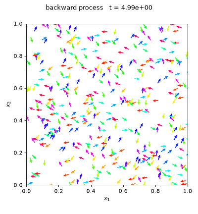

In an ongoing project with [Matt Jacobs](https://web.math.ucsb.edu/~majaco/), we are proving novel convergence rates for a diffusion model approach to solving nonholonomic control problems. [Here](https://github.com/erickimyh/Nonholonomic-DDPM) you can find code for our numerical experiments. 

The main idea is as follows: given a swarm of robots in some initial configuration, can we find a control policy that transports them to a desired target distribution? 

For example, here's a swarm of unicycle robots that we've controlled (with some error) to form a circle, all pointing to the right:

{: .align-center}

In 2024, [Elamvazhuthi, Gadginmath, and Pasqualetti](https://arxiv.org/pdf/2402.02297) discovered that under sufficient 'mixing' properties of the control vectors (known as Hormander's condition), a valid control policy can be found by computing the score function of a particle evolution in which particles diffuse along control directions. This is very similar to the technology of denoising diffusion models used for generative applications, although a key difference is that the diffusion is degenerate.

<!-- With Matt Jacobs, we are proving convergence rates that show the error of this procedure is well-controlled for time schedules that decay exponentially as particles approach the early stopping time. Our numerical experiments vet this observation.  -->

For those interested in learning more about the topic, I recommend these [lecture notes](https://sites.google.com/view/karthikelamvazhuthi/notes) by Karthik Elamvazhuthi.