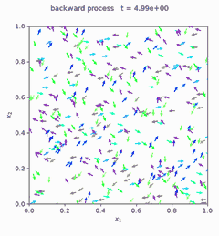

## About Me

Hi, I'm Eric! I'm an applied mathematician working in machine learning and data science. My recent interests include:

- applications of diffusion models to control problems
- predictive modeling on time-series data

I completed my PhD at UCLA in June 2026 under the supervision of Inwon Kim, where I studied optimization and differential equations relating to interfacial evolutions. Before my PhD, I spent a year working in quantitative trading at Susquehanna International Group. 

## Research Projects

### Nonholonomic Score Matching

[{: .project-thumb}](/projects/nonholonomic-score-matching/)

**Denoising diffusion models**, the machinery behind image generation, can also steer real-world systems. With [Matt Jacobs](https://web.math.ucsb.edu/~majaco/), I'm proving mathematical error guarantees for diffusion models that learn control policies for **nonholonomic systems**. An example use case is transporting robot swarms that are constrained in their movement (like a car that can't move sideways). Our findings are backed by numerical experiments, the code for which you can find [here](https://github.com/erickimyh/Nonholonomic-DDPM).

- **Toolkit:** PDEs, machine learning, stochastic calculus, numerical analysis

### Anisotropic Mean Curvature Flow (PhD Research)

At UCLA, I studied evolution equations describing how shapes such as liquid droplets and crystals evolve as surface tension pulls them toward equilibrium. Mathematically, this is modeled as a **gradient flow** of anisotropic surface energy. My research answered questions such as
- Do such evolutions always reach equilibrium, even when starting from "rough" shapes far from it?
- Can we quantify how quickly they approach equilibrium?

For further details, you can see my [PhD thesis](https://escholarship.org/content/qt6b0538wt/qt6b0538wt.pdf?v=lg).

- **Toolkit:** PDEs, optimization, dynamical systems, geometric measure theory.

## Personal Projects

- [IEEE-CIS Fraud Detection](https://github.com/erickimyh/IEEE-CIS-Fraud-Detection): I built a fraud detection model on financial transaction data from a former Kaggle competition.